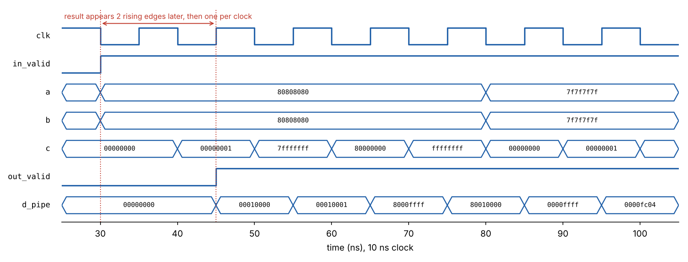

# dp4a-unit

[](https://github.com/Jusman0/dp4a-unit/actions/workflows/test.yml)

A Verilog implementation of **DP4A**: four int8 multiplies summed into a 32-bit accumulator in a single operation. NVIDIA added DP4A to Pascal GPUs (compute capability 6.1) to speed up int8 inference. This version is verified bit-exact against a Python golden model and used to compute layer 1 of my [TinyML MNIST network](https://github.com/Jusman0/tinyml-mnist-uno).

```
d = c + a[0]*b[0] + a[1]*b[1] + a[2]*b[2] + a[3]*b[3]      a, b: four int8 packed in 32 bits
```

| Check | Result |
|---|---|
| 10,000 random and edge-case vectors, all four signed/unsigned modes | **10,000 / 10,000 bit-exact**, combinational and pipelined |
| TinyML layer 1: 5 test images × 32 neurons × 196 inputs | **160 / 160** int32 accumulators match NumPy (the Arduino sketch prints logits only) |
| Max clock on an iCE40 HX8K FPGA, combinational `dp4a` between registers | ~51.6 MHz (median of 3 placement seeds; unlogged estimate, see [`synth/reports/`](synth/reports/)) |
| Max clock, `dp4a_pipe` (two-stage) on its own | ~88.5 MHz (unlogged estimate), 1.7× faster for one extra clock of latency. `dot_engine` uses the combinational `dp4a`, so this doesn't apply to it |
| iCE40 resources, `dp4a_pipe` | 1,043 LUT4s, 138 flip-flops, 93 carry cells (LUT count from an older Yosys; Yosys 0.69 gives 1,013 LUT4s) |

## Why DP4A

Almost all the work in a quantized neural network is int8 dot products. One neuron in the TinyML network has 196 inputs, which is 196 multiply-accumulates (MACs). The Arduino does them one at a time, while DP4A does four per operation, so the neuron takes 49 steps. GPU tensor cores take the same idea much further, with whole matrix tiles per instruction.

## Design

```
 a[ 7: 0] b[ 7: 0] ─► int8_mul ─┐
 a[15: 8] b[15: 8] ─► int8_mul ─┤        stage 1               stage 2
 a[23:16] b[23:16] ─► int8_mul ─┼─► [ product regs ] ─► adder tree ─► + c ─► [ reg ] ─► d
 a[31:24] b[31:24] ─► int8_mul ─┘
```

- **`int8_mul`: one multiplier for every sign mode.** Each byte is widened to 9-bit signed first. An int8 copies its sign bit, and a uint8 gets a 0 on top. After that, a single signed 9×9 multiplier handles int8×int8, int8×uint8 and uint8×uint8, so `a_signed` / `b_signed` work like PTX `dp4a.{s32,u32}.{s32,u32}`.
- **Bit widths.** Products are 18 bits (worst case 255 × 255 = 65,025), and the four-way sum is 20 bits (worst case 260,100). The sum is sign-extended to 32 bits and added to `c` modulo 2^32, the same way a 32-bit register wraps.
- **`dp4a_pipe`: two stages.** In one cycle, a signal has to pass through a multiplier, an adder tree and a 32-bit adder. Putting registers after the multipliers splits that path roughly in half. In my place-and-route runs on an iCE40, the clock rose from about 51.6 to 88.5 MHz, at the cost of one extra cycle of latency (the nextpnr logs weren't kept, so treat both numbers as estimates). Throughput stays at one DP4A per clock.
- **`dot_engine`: streaming dot product.** One DP4A feeding back into an accumulator. A `first` flag starts a new dot product from 0 on its first beat, so there's no wasted clear cycle between neurons. It's built on the combinational `dp4a`, so the 88.5 MHz figure is for `dp4a_pipe` alone, not for `dot_engine`.

## Verification

[`model/golden.py`](model/golden.py) computes every expected result with plain Python integers, independent of the Verilog. It writes the vectors to `tests/`, and the testbenches compare the RTL against them bit for bit.

- **Directed edge cases:** -128 × -128, 127 × 127, 255 × 255, mixed signs, and accumulators at 0, 2^31 - 1, 2^31 and 2^32 - 1 to exercise wraparound, all in each of the four sign modes.
- **Random vectors** fill the rest of the 10,000.
- **Real data:** the TinyML layer-1 weights and test images, checked against NumPy's int32 matrix multiply.

The first clocks of the pipelined unit, drawn from the simulation (`python3 tools/plot_wave.py`). The first vector is 0x80 × 0x80 in all four lanes, read as unsigned: 4 × 128 × 128 = 65,536 = `00010000`.



Every push runs both testbenches on GitHub's servers ([Actions](https://github.com/Jusman0/dp4a-unit/actions)). The badge at the top only shows "passing" if both print PASS.

To check the checks, I planted two bugs. Treating operand `a` as always unsigned dropped the vector test to 5,456 / 10,000. Narrowing the adder tree to 16 bits dropped it to 7,077 / 10,000. The TinyML test alone missed both, because image pixels are never negative and real sums stay small. That's why it takes directed and random vectors, not just real data.

## Run it

Needs [Icarus Verilog](https://steveicarus.github.io/iverilog/) (`brew install icarus-verilog`). To look at waveforms, open `sim/dp4a.vcd` in GTKWave or in the browser-based [Surfer](https://app.surfer-project.org/). Yosys and nextpnr-ice40 (both in the [OSS CAD Suite](https://github.com/YosysHQ/oss-cad-suite-build)) are only needed for synthesis.

```bash
make test               # both testbenches; ends with ALL TESTS PASSED
make wave               # dp4a testbench + waveform in GTKWave
make synth              # gate counts: generic and iCE40
bash synth/timing.sh    # place and route, max clock frequency
python3 model/golden.py # regenerate tests/*.hex
python3 tools/plot_wave.py  # redraw docs/waveform.png from the last simulation
```

A passing `make test` run (macOS, Icarus Verilog 13.0; make's command lines and Icarus's VCD and `$finish` messages left out):

```
dp4a       (combinational): 10000/10000 match
dp4a_pipe  (2-stage)      : 10000/10000 match, 10000 results out
PASS
image 0, neuron 0: acc = 23470 (expected 23470)
image 0: 32/32 neurons match
image 1: 32/32 neurons match
image 2: 32/32 neurons match
image 3: 32/32 neurons match
image 4: 32/32 neurons match
7840 dp4a beats for 160 neurons (49 per neuron)
PASS
ALL TESTS PASSED
```

## Layout

```
rtl/int8_mul.v          one lane: int8/uint8 x int8/uint8 -> 18-bit signed
rtl/dp4a.v              combinational dp4a
rtl/dp4a_pipe.v         two-stage pipelined dp4a
rtl/dot_engine.v        streaming dot product built on dp4a
tb/tb_dp4a.v            10,000-vector bit-exact check, both versions
tb/tb_tinyml_neuron.v   TinyML layer 1 through dot_engine
model/golden.py         Python golden model and vector generator
model/tinyml_layer1.npz layer-1 weights and test images from tinyml-mnist-uno
synth/                  Yosys scripts, timing wrappers, place-and-route script
synth/reports/          Yosys 0.69 re-run and tool versions
tools/plot_wave.py      draws docs/waveform.png from the simulation
.github/workflows/      runs the testbenches on every push
```

## Series

Each project builds the same neural-network operation one level closer to a GPU:

1. [analog-neuron](https://github.com/Jusman0/analog-neuron): a weighted sum computed by resistors
2. [tinyml-mnist-uno](https://github.com/Jusman0/tinyml-mnist-uno): the network in int8 on an 8-bit CPU, one MAC at a time
3. **dp4a-unit**: the int8 dot product as dedicated hardware, four MACs per clock
4. [tiny-tensor-core](https://github.com/Jusman0/tiny-tensor-core): the whole network in hardware, 32 MACs per clock, bit-exact on all 10,000 MNIST test images
